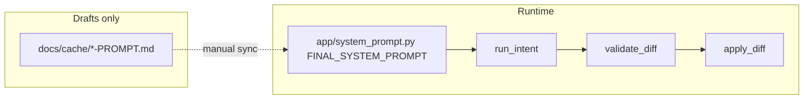

# Ops Hardening Implementation Plan

Improve Ops feedback, schema hygiene, and prompt/validator parity. Consolidate the runtime system prompt into `app/system_prompt.py`; treat `docs/cache/*-PROMPT.md` as drafts only.

**Execution rule:** one logical phase per commit. Strip `Co-authored-by:` trailers after each commit if the hook re-adds them. Run ` .venv/bin/python -m unittest discover -s tests -q` before every commit.

---

## Goals

| # | Recommendation | Outcome |
|---|----------------|---------|
| 1 | Self-explanatory Ops failures | User sees what failed and what the model sent |
| 2 | Prompt ↔ validator lockstep | Tests fail if prompt and `ALLOWED_DIFF_KEYS` drift |
| 3 | Schema dedupe on read | Duplicate column metadata cannot break forms |
| 4 | Field-edit decision tree | Prompt + Ops copy guide hide/update/remove |
| 5 | Single prompt source | `load_system_prompt()` reads only `system_prompt.py` |
| 6 | Two-step bootstrap hint | Empty-schema guidance in Ops UI and prompt |

**Out of scope:** `remove_tables`, FTS5, macOS notifications, live Home refresh, npm frontend.

---

## Phase 0 — Plan (this file)

- [x] Write this plan
- **Commit:** `Add Ops hardening implementation plan.`

---

## Phase 1 — Structured validation errors (backend)

**Files:** `app/schema_validate.py`, `app/intent.py`, `app/server.py`

- [x] Extend `ValidationError` with optional `detail: dict`
- [x] Populate `detail` in high-traffic failures
- [x] Include `rejected_diff` in API response
- [x] Tests: `tests/test_intent_errors.py`

**Commit:** `Return structured validation errors and rejected diff from intent API.`

---

## Phase 2 — Ops UI for validation failures (frontend)

**Files:** `static/ops.html`, `static/js/ops.js`, `tests/test_slice8.py` (contract)

- [x] Collapsible “What the model returned” panel
- [x] Detail summary line on intent 400
- [x] Pretty-print `rejected_diff`

**Commit:** `Show rejected diff and validation detail on Ops intent errors.`

---

## Phase 3 — Schema column dedupe on read

**Files:** `app/config.py`, `tests/test_config.py`

- [x] Dedupe columns by name (keep first)
- [x] Persist repair and log event

**Commit:** `Dedupe duplicate column metadata when loading schema.`

---

## Phase 4 — Consolidate runtime prompt in `system_prompt.py` (#5)

**Files:** `app/system_prompt.py`, `docs/cache/FINAL-PROMPT.md`, `docs/cache/MVP-PROMPT.md`, `tests/test_system_prompt.py`

- [x] `FINAL_SYSTEM_PROMPT` embedded in module
- [x] `load_system_prompt()` returns constant only
- [x] DRAFT banners on cache prompts (local; gitignored)
- [x] Updated `test_system_prompt.py`

**Commit:** `Load FINAL system prompt only from app/system_prompt.py.`

---

## Phase 5 — Prompt ↔ validator contract tests (#2)

**Files:** `tests/test_prompt_contract.py`, `app/system_prompt.py`

- [x] `PROMPT_DIFF_KEYS` exported
- [x] Subset/superset checks vs `ALLOWED_DIFF_KEYS`
- [x] Golden diff fixtures

**Commit:** `Add prompt and validator contract tests.`

---

## Phase 6 — Field-edit guide and bootstrap hints (#4, #6)

**Files:** `app/system_prompt.py`, `static/ops.html`, `static/js/ops.js`, `README.md`

- [x] Changing fields + empty schema bootstrap in prompt
- [x] Ops UI hints
- [x] README note

**Commit:** `Add field-edit and bootstrap guidance to prompt and Ops UI.`

---

## Phase 7 — Validation message sweep (optional polish)

**Files:** `app/schema_validate.py`

- [x] Sorted key lists for remaining unknown-key paths

**Commit:** `Improve remaining validation error messages with key lists.`

---

## Phase 8 — Definition of done

Manual checklist:

1. Ops 400 on bad `add_columns` shows path, keys, and JSON panel.
2. `load_system_prompt()` does not read `docs/cache/`.
3. Schema with duplicate columns repairs on load.
4. Contract tests green; full suite green (`88+` tests).
5. README updated.

---

## Suggested commit order (summary)

| Order | Phase | Commit message (short) |
|-------|-------|------------------------|
| 1 | 0 | Add Ops hardening implementation plan |
| 2 | 1 | Return structured validation errors and rejected diff from intent API |
| 3 | 2 | Show rejected diff and validation detail on Ops intent errors |
| 4 | 3 | Dedupe duplicate column metadata when loading schema |
| 5 | 4 | Load FINAL system prompt only from app/system_prompt.py |
| 6 | 5 | Add prompt and validator contract tests |
| 7 | 6 | Add field-edit and bootstrap guidance to prompt and Ops UI |
| 8 | 7 | Improve remaining validation error messages with key lists |

---

## Architecture (after Phase 4)

---

## Risks

| Risk | Mitigation |
|------|------------|
| Large `FINAL_SYSTEM_PROMPT` string hard to edit | Module docstring points to cache drafts for prose editing, then copy in |
| `rejected_diff` leaks secrets | Diff is schema-only; never include `.env` |
| Dedupe keeps wrong duplicate | Keep first; log repair event; rare in practice |
| Contract tests brittle to prompt prose | Test keys and golden diffs, not full prompt text equality |

---

## When executing

1. Mark plan phase todos in this file (`pending` → `completed`).
2. Do not batch phases into one commit.
3. Restart server after backend/UI phases.
4. User can review each commit on `main` independently.
