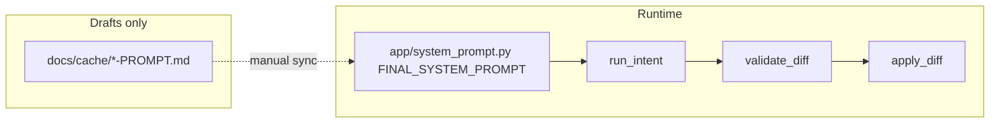

# Ops Hardening Implementation Plan

Improve Ops feedback, schema hygiene, and prompt/validator parity. Consolidate the runtime system prompt into `app/system_prompt.py`; treat `docs/cache/*-PROMPT.md` as drafts only.

**Execution rule:** one logical phase per commit. Strip `Co-authored-by:` trailers after each commit if the hook re-adds them. Run ` .venv/bin/python -m unittest discover -s tests -q` before every commit.

---

## Goals

| # | Recommendation | Outcome |
|---|----------------|---------|
| 1 | Self-explanatory Ops failures | User sees what failed and what the model sent |
| 2 | Prompt ↔ validator lockstep | Tests fail if prompt and `ALLOWED_DIFF_KEYS` drift |
| 3 | Schema dedupe on read | Duplicate column metadata cannot break forms |
| 4 | Field-edit decision tree | Prompt + Ops copy guide hide/update/remove |
| 5 | Single prompt source | `load_system_prompt()` reads only `system_prompt.py` |
| 6 | Two-step bootstrap hint | Empty-schema guidance in Ops UI and prompt |

**Out of scope:** `remove_tables`, FTS5, macOS notifications, live Home refresh, npm frontend.

---

## Phase 0 — Plan (this file)

- [x] Write this plan
- **Commit:** `Add Ops hardening implementation plan.`

---

## Phase 1 — Structured validation errors (backend)

**Files:** `app/schema_validate.py`, `app/intent.py`, `app/server.py`

1. Extend `ValidationError` with optional `detail: dict` (e.g. `path`, `unknown_keys`, `hint`).
2. Populate `detail` in high-traffic failures:
   - `add_columns` / `add_screens` / `update_columns` / `remove_columns` unknown keys (include sorted key list + expected shape hint)
   - Column type / widget mismatches (include column name and bad value)
3. In `run_intent`, on `ValidationError` after parse:
   - Re-raise or wrap with `detail` preserved
   - Include `rejected_diff` in API response (parsed JSON, truncated if huge — cap ~8 KB)
4. `POST /api/intent` 400 body shape:

```json
{
  "error": "human message",
  "error_code": "unknown_key",
  "detail": { "path": "add_columns[0]", "unknown_keys": ["name", "type"] },
  "rejected_diff": { "summary": "...", "add_columns": [] }
}
```

5. Log `rejected_diff` keys in `intent.apply.fail` detail (not full diff in jsonl if large).

**Tests:** `tests/test_intent_errors.py` (new) — fake LLM returns bad `add_columns` shape; API returns `detail` + `rejected_diff`.

**Commit:** `Return structured validation errors and rejected diff from intent API.`

---

## Phase 2 — Ops UI for validation failures (frontend)

**Files:** `static/ops.html`, `static/js/ops.js`, `tests/test_slice8.py` (contract)

1. Below `#intent-error`, add collapsible **“What the model returned”** (`<details>` + `<pre>`).
2. On intent 400, show `error`, optional `detail` summary line (e.g. `add_columns[0]: unknown keys name, type — use table and column only`).
3. Pretty-print `rejected_diff` when present.
4. Keep success path unchanged.

**Tests:** Extend `test_ops_page_contract` for new DOM ids; optional js-less API test only.

**Commit:** `Show rejected diff and validation detail on Ops intent errors.`

---

## Phase 3 — Schema column dedupe on read

**Files:** `app/config.py`, `app/log.py` (optional emit), `tests/test_config.py` or `tests/test_final.py`

1. In `read_or_create_schema`, after loading tables:
   - Per table, dedupe `columns` by `name` (keep **first** occurrence).
   - If duplicates removed, `emit` once: `schema.repair.duplicate_columns` with table + column names.
2. Do **not** auto-write repaired schema unless duplicates found (write back once to fix appdir — avoids read side effects on every request). Only persist repair when dedupe happened.

**Tests:** Load schema with duplicate `lives_online` entries; assert one remains and file rewritten.

**Commit:** `Dedupe duplicate column metadata when loading schema.`

---

## Phase 4 — Consolidate runtime prompt in `system_prompt.py` (#5)

**Files:** `app/system_prompt.py`, `docs/cache/FINAL-PROMPT.md`, `docs/cache/MVP-PROMPT.md`, `tests/test_system_prompt.py`

1. Add `FINAL_SYSTEM_PROMPT` string:
   - Merge content from current `docs/cache/FINAL-PROMPT.md` (post-`---` body)
   - Merge unique parts of `COLUMN_RULES_SUPPLEMENT` (no duplication with MVP sections)
   - Include FINAL keys: formulas, rules, reminders, jobs, layouts, roles, grants, import, sync, `update_columns`, `remove_columns`, layout screens
   - **Remove** stale MVP line: “ignore dashboard / reminder / login” (FINAL supports these)
   - Keep hooks section inline (drop `_hooks_supplement()` indirection)
2. `load_system_prompt()` → `return FINAL_SYSTEM_PROMPT` only (no filesystem read).
3. Keep `SYSTEM_PROMPT` as deprecated alias or trim to re-export for tests; document in module docstring.
4. Add banner at top of each `docs/cache/*-PROMPT.md`:

```markdown
> **DRAFT** — Not loaded at runtime. Source of truth: `app/system_prompt.py` (`FINAL_SYSTEM_PROMPT`).
```

5. Update `test_system_prompt.py`:
   - Assert `load_system_prompt()` equals `FINAL_SYSTEM_PROMPT`
   - Assert no `docs/cache` read in `intent.py` / `llm.py` (existing)
   - Assert key FINAL sections present (`add_layouts`, `remove_columns`, layout screen)

**Commit:** `Load FINAL system prompt only from app/system_prompt.py.`

---

## Phase 5 — Prompt ↔ validator contract tests (#2)

**Files:** `tests/test_prompt_contract.py` (new), `app/schema_validate.py` (export `ALLOWED_DIFF_KEYS` if needed)

1. Parse `FINAL_SYSTEM_PROMPT` output-object JSON example (or maintain explicit `PROMPT_DIFF_KEYS` frozenset in `system_prompt.py` exported for tests).
2. Assert every key in prompt output object ⊆ `ALLOWED_DIFF_KEYS`.
3. Assert every key in `ALLOWED_DIFF_KEYS` appears in prompt (or in documented FINAL-only list) — prevents orphan validator keys.
4. Golden diff fixtures (minimal valid):
   - `add_columns` nested shape
   - `layout` screen + `add_layouts`
   - `hide_columns` + `remove_columns`
   - Each passes `validate_diff` against empty schema (where applicable)

**Commit:** `Add prompt and validator contract tests.`

---

## Phase 6 — Field-edit guide and bootstrap hints (#4, #6)

**Files:** `app/system_prompt.py`, `static/ops.html`, `static/js/ops.js`, `README.md`

### Prompt (`FINAL_SYSTEM_PROMPT`)

Add **## Changing fields** table:

| User intent | Use |
|-------------|-----|
| Stop showing | `hide_columns` |
| Rename label | `update_labels` |
| Change widget (same type) | `update_columns` |
| Text → checkbox | `add_columns` + `hide_columns` or `remove_columns` |
| Delete field and data | `remove_columns` |

Add **## Empty schema bootstrap**:

- First intent: tables + list/form screens only.
- Second intent: dashboard (`add_layouts` + layout screen), rules, reminders.

### Ops UI

- Short hint under intent textarea (static HTML): field-change and two-step bootstrap bullets.
- Optional: show hint only when `GET /api/schema` has `version === 0` or no screens (small `ops.js` fetch on load).

### README

- Note runtime prompt lives in `app/system_prompt.py`.
- Note `docs/cache/` prompts are design drafts.

**Commit:** `Add field-edit and bootstrap guidance to prompt and Ops UI.`

---

## Phase 7 — Validation message sweep (optional polish)

**Files:** `app/schema_validate.py`

1. Replace remaining generic `"has unknown keys"` messages with sorted key lists (hide_columns, update_labels, add_tables, etc.).
2. Ensure all raise paths set `detail` where cheap.

**Commit:** `Improve remaining validation error messages with key lists.`

---

## Phase 8 — Definition of done

Manual checklist:

1. Ops 400 on bad `add_columns` shows path, keys, and JSON panel.
2. `load_system_prompt()` does not read `docs/cache/`.
3. Schema with duplicate columns repairs on load.
4. Contract tests green; full suite green (`88+` tests).
5. README updated.

---

## Suggested commit order (summary)

| Order | Phase | Commit message (short) |
|-------|-------|------------------------|
| 1 | 0 | Add Ops hardening implementation plan |
| 2 | 1 | Return structured validation errors and rejected diff from intent API |
| 3 | 2 | Show rejected diff and validation detail on Ops intent errors |
| 4 | 3 | Dedupe duplicate column metadata when loading schema |
| 5 | 4 | Load FINAL system prompt only from app/system_prompt.py |
| 6 | 5 | Add prompt and validator contract tests |
| 7 | 6 | Add field-edit and bootstrap guidance to prompt and Ops UI |
| 8 | 7 | Improve remaining validation error messages with key lists |

---

## Architecture (after Phase 4)



---

## Risks

| Risk | Mitigation |
|------|------------|
| Large `FINAL_SYSTEM_PROMPT` string hard to edit | Module docstring points to cache drafts for prose editing, then copy in |
| `rejected_diff` leaks secrets | Diff is schema-only; never include `.env` |
| Dedupe keeps wrong duplicate | Keep first; log repair event; rare in practice |
| Contract tests brittle to prompt prose | Test keys and golden diffs, not full prompt text equality |

---

## When executing

1. Mark plan phase todos in this file (`pending` → `completed`).
2. Do not batch phases into one commit.
3. Restart server after backend/UI phases.
4. User can review each commit on `main` independently.
